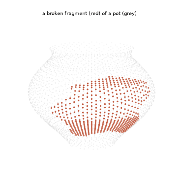

# Rebuilding broken pottery from a single fragment

> **Work in progress.** This is an early public snapshot. The trained model, datasets and
> evaluation harness are not included yet (several of the source scans have licenses that don't
> allow redistribution), so only the geometry and the scan-intake code run from this repo.



Most wheel-thrown pots are close to surfaces of revolution. So a single sherd carries a lot of
information: estimate the pot's symmetry axis from the fragment, spin the fragment around it, and
you get the wall at every height the fragment covers. A learned point-cloud model fills in only the
heights the fragment never reaches (the grey parts above).

**Early result** (simulated breakage of digital vessel scans, sealed held-out set of 81 vessels):
this hybrid cut missing-section error by **20.6%** compared with the learned model alone
(0.187 vs 0.235), and beat geometry alone (0.289). It can still fail when the axis
estimate is off (errors up to 75° on hard fragments) or when the vessel isn't symmetric.

## What's here

| File | What it does |
|---|---|
| `symhybrid_core.py` | Axis from the fragment's face normals (every normal line of a surface of revolution crosses the axis), revolve, resample |
| `intake/` | Turns a real 3D scan of a sherd into a clean fragment: load OBJ/PLY/STL, weld, decimate, split walls from break faces, orient upright |
| `demo.py` | Makes the GIF above on a synthetic pot |

```sh
pip install numpy matplotlib pillow
python demo.py                  # writes demo/demo.gif
python intake/test_intake.py    # synthetic sherd tests
```

## Next

- Scan real sherds and run them through `intake/`
- Publish a cleaned-up model and an evaluation that runs on openly licensed scans
